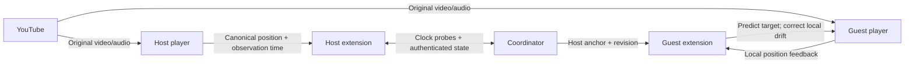
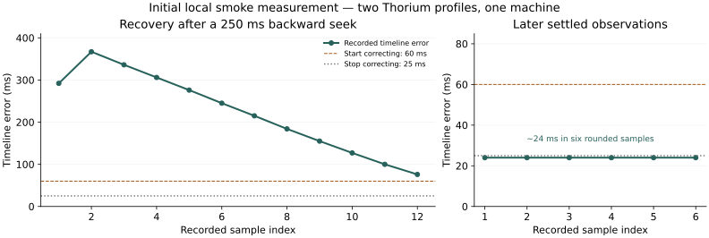

# YouTube In Sync

**Automatic YouTube watch-party synchronization. One host anchors the room. Everyone else follows.**

[](https://github.com/vitural2904/youtube-in-sync/releases)
[](https://github.com/vitural2904/youtube-in-sync/actions/workflows/ci.yml)
[](LICENSE)

[Download v0.1](https://github.com/vitural2904/youtube-in-sync/releases/download/v0.1/youtube-in-sync-v0.1.zip) · [Installation](#installation) · [How it works](#how-it-works) · [Measurements](#initial-measurements) · [Contributing](CONTRIBUTING.md)

## Status and purpose

**v0.1 is an experimental first release. The UI is rough. The core synchronization behavior is working in initial local tests.** The popup currently uses Vietnamese labels. Interface polish, wider compatibility, and internet-scale validation remain open work.

Use it for esports watch parties, event reactions between streamers, or friends watching from different locations. Each participant watches the original YouTube stream. A small coordinator exchanges timing state. It does not relay video or audio.

Joining automatically finds the shared timeline, seeks when necessary, and continuously corrects drift. No manual scene matching. A geographically distributed group needs a shared, reachable coordinator; no public hosted coordinator is included.

| Included in v0.1 | Current boundary |
|---|---|
| Chromium Manifest V3 extension | Chromium 116+ API target; tested on Thorium 138 |
| YouTube desktop watch pages | Same `www.youtube.com/watch?v=...` video in every session |
| Host-led play, pause, and seek | One bound player per browser profile; up to eight members |
| Automatic live timeline mapping | Requires usable timing metadata and a reachable seek position |
| Clock estimation, drift correction, reconnect | Scheduling, buffering, and network asymmetry affect accuracy |
| Self-hosted Node.js coordinator | In-memory rooms; restart loses state |

## Installation

### 1. Choose a coordinator

For a personal test, install Node.js 22+, download the [source](https://github.com/vitural2904/youtube-in-sync/archive/refs/tags/v0.1.zip), extract it, then run:

```sh
npm ci --omit=dev
npm start
```

The default endpoint is `ws://127.0.0.1:8787/ws`. Check `http://127.0.0.1:8787/health`.
On PowerShell, use `npm.cmd` if your execution policy blocks `npm.ps1`.

**Loopback only connects profiles on the same computer.** For friends on different computers, one person must [deploy a shared HTTPS/WSS coordinator](docs/deployment.md). Everyone enters the same `wss://your-server/ws` endpoint. Remote endpoints require a separate permission grant in the popup.

### 2. Install the extension

1. Download [youtube-in-sync-v0.1.zip](https://github.com/vitural2904/youtube-in-sync/releases/download/v0.1/youtube-in-sync-v0.1.zip). Optionally verify it against the release's `SHA256SUMS.txt`.
2. Extract it to a permanent folder. This is an unpacked extension, not a Web Store installer.
3. Open `chrome://extensions`. In Edge, use `edge://extensions`.
4. Enable **Developer mode**, choose **Load unpacked**, and select the folder containing `manifest.json`.

Thorium, Chrome, Edge, Brave, and other Chromium browsers are intended targets. Their installation policies differ. Only Thorium has been exercised so far.

### 3. Start a watch party

1. Open the same YouTube `/watch` video on each computer.
2. Open **YouTube In Sync** from the extension toolbar. Set the shared coordinator endpoint.
3. The host clicks **Tạo phòng với video này** — create a room for this video.
4. Click **Sao chép mã phòng** — copy room code — and share it privately.
5. Guests enter that code under **Mã phòng**, then click **Vào phòng với video này** — join with this video.
6. Watch. The host's YouTube controls set the room position. Guests catch up automatically.

**Đã đồng bộ** means the local player reached the controller's timing tolerance. **Ngừng theo nhóm / Rời phòng** stops local control and leaves. If autoplay with sound is blocked, click YouTube's play button once. Ads and unavailable metadata temporarily suspend synchronization; the extension retries automatically.

## Components

| Component | Responsibility | Main files |
|---|---|---|
| Popup | Explicit tab binding, create/join/leave, endpoint permission | `extension/popup.*` |
| Service worker | Room session, WebSocket, clock samples, timeline reads | `extension/background.js` |
| YouTube adapter | Read verified video ID, player/media offset, live origin | `extension/youtube.js` |
| Isolated controller | Validate binding, check seekable ranges, control player | `extension/content.js` |
| Timing math | Prediction, four-timestamp estimation, bounded feedback | `extension/sync.js` |
| Coordinator | Room authority, authentication, validation, bounded fan-out | `server/index.js` |

The stack is plain JavaScript, HTML/CSS, Chromium extension APIs, Node.js HTTP, and `ws`. No frontend framework, database, video proxy, or transcoding service is required.

## How it works



**The host is the single anchor.** Guests cannot change the room timeline. A slow guest adjusts its own player rather than forcing everyone backward. Host buffering freezes the last usable anchor. Host disconnection suspends following; host departure closes the room. There is no host transfer in v0.1.

### 1. Map media time onto the YouTube timeline

Two sessions of the same livestream can have different local media origins. Comparing raw `video.currentTime` values can therefore synchronize the wrong scenes.

The adapter reads canonical player time and verifies its relationship to the local media clock:

```text
canonicalPosition = mediaPosition + playerToMediaOffset
guestMediaTarget  = canonicalTarget - guestPlayerToMediaOffset
```

For live video, it checks `getProgressState().offset` and the live-origin value `getVideoStats().lio`. Origins must agree within two seconds. For VOD, verified player and media clocks must agree within 250 ms. Mappings expire after 2.5 seconds and refresh approximately once per second.

**These live adapter methods are internal YouTube interfaces.** They were inspected in the tested player build, not established as a stable public API. Missing or inconsistent data suspends control. The public [YouTube IFrame API reference](https://developers.google.com/youtube/iframe_api_reference) provides timing context; it does not document these internal live fields.

### 2. Estimate the clock offset

Each client records four timestamps: client send `t1`, server receive `t2`, server send `t3`, client receive `t4`.

```text
offset = ((t2 - t1) + (t3 - t4)) / 2
RTT    = (t4 - t1) - (t3 - t2)
```

This borrows the calculation from [RFC 5905, §8](https://www.rfc-editor.org/rfc/rfc5905.html#section-8). It is an application-level WebSocket estimate, not a full NTP implementation. The client retains twelve recent samples, rejects invalid/high-delay samples, and selects the lowest-RTT valid sample. Unequal forward/reverse delay still introduces uncertainty.

### 3. Compensate the age of timing data

A host anchor is `(position, rate, observationTime)`. With clock time in milliseconds and media position in seconds:

```text
target(now) = anchorPosition + rate * (now - anchorTime) / 1000
```

Observation timestamps use `performance.timeOrigin + performance.now()` to relate document and worker clocks. The worker translates the observation onto its estimated server clock. The guest preserves the target's original timestamp and extrapolates again when applying it. Observed message age and timer delay are included without adding a whole RTT twice. See [W3C High Resolution Time, §6](https://www.w3.org/TR/hr-time-2/#monotonic-clock).

### 4. Correct residual drift smoothly

Let `e = targetPosition - actualPosition`, in seconds. The bounded speed multiplier is:

```text
multiplier(e) = 1 + 0.03 * tanh(0.35 * e / 0.03)
```

The function approaches a maximum ±3% adjustment and becomes gentler near zero. Hysteresis prevents rapid switching between correction and normal playback.

| Rule | Value |
|---|---:|
| Local controller interval | 100 ms, subject to browser scheduling |
| Clock probe / host update interval | Approximately 1 second |
| Start rate correction | Absolute error ≥60 ms |
| Stop an active correction | Absolute error <25 ms |
| Hard seek threshold | Absolute error >2 seconds |
| Minimum spacing between controller seeks | 3 seconds |
| Target expiry | 3.5 seconds |

After a large seek, rate adjustment briefly waits for the player to settle. A small initial echo can converge gradually rather than disappear immediately. The system estimates media position; it does not measure speaker, OS mixer, or Bluetooth output latency.

### 5. Bound authority and state

Rooms and members use in-memory maps. Clock samples use a fixed-length recent-sample array. Snapshots carry a server epoch and increasing revision. Authentication is room-scoped. Only the host can publish anchors; stale revisions are rejected. With at most eight members, fan-out is linear in room size. No all-to-all peer mesh is needed.

## Initial measurements

**Local smoke observations, not a WAN benchmark or latency guarantee.** Two fresh Thorium 138 profiles ran on one Windows machine with a loopback coordinator, Node.js 22.19.0, one host, and one guest.



*Figure 1. Recorded canonical timeline error. Panels show separate observation windows; sample index is not a continuous wall-clock axis. Source: [recorded data](docs/benchmarks/initial-local.json).*

| Trial | Observation | Limit |
|---|---|---|
| Guest started 60 seconds behind | Join triggered automatic alignment | One live-video demonstration |
| Guest moved 250 ms backward | Error briefly reached 367 ms during buffering, then fell to 76 ms across twelve samples | Approximately one-second sampling; one trace |
| Later settled window | Six samples rounded to approximately 24 ms each | Roughly 0.5-second sampling; rounding does not imply zero jitter |
| Automated checks | 28 JavaScript tests and one packaging test | Controlled-player tests complement real-browser smoke tests |

Error is predicted host position minus guest canonical position **at the guest observation time**. It is not acoustic or photon-to-photon delay. No geographical, load, packet-loss, or long-duration benchmark has been completed. See [method and reproduction notes](docs/validation.md).

## Security and privacy boundaries

- Room codes are bearer invitations. Keep them private. Member tokens remain in trusted extension session storage.
- Pages and client telemetry remain untrusted. A fixed page-world reader receives only the public video ID, never extension credentials or privileged callbacks.
- Tab/document binding, content ID, timeline ID, and live origin are checked before control. Only the packaged popup can request create/join/leave.
- The server checks authorization per message. Payload, rate, connection, room, member, and expiry limits bound abuse. Remote deployments require allowed extension origins and TLS.
- Origin checks cannot prove that a modified client genuinely watches YouTube. The host can control its own room within allowed operations.
- The coordinator receives timing and room state, not video/audio, YouTube cookies, or browsing history. Network addresses are visible to the server and used for connection limits.

See [SECURITY.md](SECURITY.md) for deployment boundaries and private reporting.

## Develop or fork

```sh
git clone https://github.com/vitural2904/youtube-in-sync.git
cd youtube-in-sync
git switch -c feat/your-change
npm ci
npm test
npm run check
npm start
```

Load `extension/` as unpacked. No compilation is required. After changing it, reload the extension, refresh YouTube, and create/join again. Use fresh profiles for repeatable trials. Windows/Thorium users can run `scripts/open-thorium.ps1` twice for separate profiles.

Build the release ZIP with Python 3.9+:

```sh
python scripts/package-extension.py
```

The package contains an explicit extension-file allowlist and the license. Archives and SHA-256 checksums go into ignored `dist/`. Profiles, environment files, caches, and local traces are excluded from Git. To regenerate Figure 1, optionally install `matplotlib==3.10.3` and run `python scripts/plot-benchmark.py`.

## Contributing

Anyone may use, modify, fork, and contribute under the [MIT license](LICENSE).

**Open an issue first. Develop on a branch other than `main`.** Link the issue in your pull request. Explain what changed, why, and how you tested it. Show before/after evidence for synchronization behavior and screenshots for UI changes. See [CONTRIBUTING.md](CONTRIBUTING.md).

Useful next work: popup UX and localization, additional Chromium browsers, geographically separated trials, automated real-player regressions, and more resilient live metadata handling.

## Known limits

Internal YouTube API changes can break mapping. Unseekable streams cannot always reach the host. Ads, unavailable ranges, autoplay restrictions, background throttling, and output hardware can prevent tight synchronization. Shorts, embedded players, `/live` channel URLs, cross-source streams, mobile apps, and TV apps are outside this release. Rooms expire after two hours; disconnected members have a short reconnect window. No durable room storage is provided.

This project is independent and is not affiliated with or endorsed by YouTube or Google.

## Star history

[](https://www.star-history.com/#vitural2904/youtube-in-sync&Date)

The external chart may have little or no data for a new repository.
